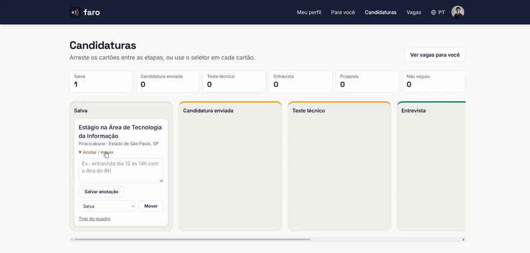
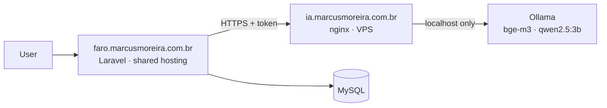
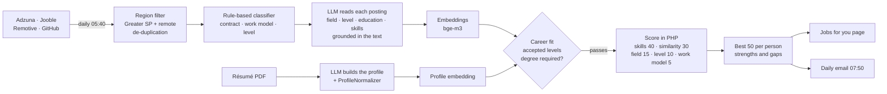

<p align="center">
  
</p>

<p align="center"><strong>The AI that finds the right jobs for you.</strong></p>

<p align="center">
  <a href="https://faro.marcusmoreira.com.br">faro.marcusmoreira.com.br</a> ·
  <a href="docs/ROADMAP.md">Roadmap</a> ·
  <a href="docs/DATABASE.md">Database</a> ·
  <a href="docs/DEPLOY.md">Deploy</a>
</p>

<p align="center">
  <a href="https://github.com/MarcusVBMoreira/faro-vagas/actions/workflows/ci-deploy.yml"></a>
</p>

---

**Faro** helps people in Brazil find jobs in **any profession**: apprentices and interns, nurses, salespeople, warehouse staff, cooks, teachers, technicians, developers and managers. You upload your résumé, an AI builds your profile, and Faro ranks job openings by how well they fit you, showing a **match score**, your **strengths** and **what's missing** for each one.

The site is available in **Portuguese, English and Spanish** (it targets the Brazilian job market, so Portuguese is the default). The code comments are in Portuguese; this documentation is in English.

> Portfolio project, built in public in one month. See how it was planned and shipped week by week in the [roadmap](docs/ROADMAP.md).

<p align="center">
  
</p>

## Features

- [x] Sign up with **email verification by 6-digit code**, optional **two-step login** by email, brute-force throttling, password reset
- [x] Site in **Portuguese, English and Spanish** (switcher, browser detection, saved per account, emails in the user's language)
- [x] Résumé upload (PDF) with text extraction and AI parsing in a background queue
- [x] Profile for **every profession**: 28 fields, 14 career levels (apprentice to director), contract types, salary expectation, education level, work history, education, languages, driver's license, contact
- [x] Optional profile photo (cropped to 400×400 JPEG, EXIF/GPS stripped) and a profile completeness meter
- [x] Optional, consent-based disability (PcD) field for affirmative openings, never used in scoring
- [x] Account deletion that wipes all user data and files (LGPD, Brazil's GDPR)
- [x] Daily job collection for Greater São Paulo + remote jobs, every field (Adzuna, Jooble, Remotive, GitHub), with search and filters
- [x] Add a job by hand; international remote jobs that accept people in Brazil (opt-in)
- [x] Matching with a 0–100 score, strengths and gaps for every job (embeddings + a transparent score computed in code)
- [x] Application Kanban board (drag and drop, keyboard-friendly fallback, notes, history)
- [x] Daily email with the best new jobs, in the user's language, with one-click unsubscribe
- [x] "What to learn": the skills that most often appear as gaps in your best matches

## Self-hosted AI, no paid API

The AI runs on the project's own VPS with **Ollama**, exposed at `ia.marcusmoreira.com.br` behind nginx with HTTPS, a bearer token and rate limiting. Résumés **never leave the project's servers**, and the cost per request is zero.



Before choosing the models, I benchmarked them on the VPS (1 vCPU, 4 GB RAM, no GPU). The scripts and results are in [`ops/vps/`](ops/vps/):

| Task | Where it runs | Why |
|---|---|---|
| Embeddings | `bge-m3` on the VPS (~1 s per job posting) | Fast on CPU and handles Portuguese well |
| Parsing résumés and job postings into JSON | `qwen2.5:3b` on the VPS, in a queue (~25–40 s) | Got every field right in the benchmark; the 1.5b model mislabeled the seniority level |
| Match score, strengths and missing skills | **Plain PHP** (skill list comparison + similarity) | Must be exact: in the benchmark, small models invented missing skills |

What small models still get wrong ("3º semestre" instead of `3`, `"Mauá/SP"` as a city, "Enfermagem" instead of the `saude` field key, "+55 11 9..." phone formats, "atual" as an end date) is fixed deterministically in [`ProfileNormalizer`](app/Support/ProfileNormalizer.php), and the response is constrained with a JSON Schema.

## How matching works

Sending every job posting to an LLM would be slow on a 1-CPU server, so Faro uses a funnel where the AI only does what code can't:



1. **Career fit** first: an intern never sees senior roles, and a student never sees jobs that require the degree they are still earning (except internships). The levels a person accepts are editable in the profile.
2. **Semantic similarity**: profile and postings become embeddings (`bge-m3` on the project's VPS), compared with cosine similarity in PHP (shared hosting has no vector database). The scale was calibrated on production data.
3. **Score in code**, never by the LLM: requirements are compared with the whole profile text, unknown information gets partial credit, and sensitive data (disability) is never read. Every point of the score can be explained, and the page shows what you have and what is missing.

## Tech stack

- **Laravel 12** (PHP 8.3), Blade, Tailwind CSS 4, Vite
- **MySQL** in production; queue and cache in the database (no Redis needed on shared hosting)
- **Ollama** on a VPS (`bge-m3` + `qwen2.5:3b`), called over HTTPS
- **PHPUnit** tests running against MySQL 8 on **GitHub Actions**
- **Continuous deployment** to Hostinger over SSH on every push to `main`, plus VPS operations as versioned scripts run by GitHub Actions

## Running locally

Requirements: PHP 8.2+, Composer, Node 20+ (on Windows, XAMPP ships PHP).

```bash
git clone https://github.com/MarcusVBMoreira/faro-vagas.git
cd faro-vagas
composer install
cp .env.example .env          # Windows: copy .env.example .env
php artisan key:generate
php artisan migrate --seed    # uses SQLite at database/database.sqlite
npm install
composer run dev              # http://localhost:8000 (server, queue, logs and Vite)
```

To use XAMPP's MySQL, set `DB_CONNECTION=mysql`, `DB_DATABASE=faro`, `DB_USERNAME=root` and an empty `DB_PASSWORD` in `.env`.
Résumé parsing needs `AI_API_KEY` (the token of your Ollama endpoint) or your own local Ollama with `AI_BASE_URL=http://localhost:11434`.

Job collection needs free API keys (`ADZUNA_APP_ID`, `ADZUNA_APP_KEY`, `JOOBLE_API_KEY`); without them those sources are skipped and Remotive and GitHub still work.

Useful commands:

```bash
php artisan test                         # 150+ tests
php artisan faro:fetch-jobs              # collect jobs now
php artisan faro:compute-matches --sync  # recalculate "jobs for you"
php artisan faro:send-digests            # send the daily email
php artisan faro:diagnostico             # health check (database, AI, mail, cron, queue)
```

## Project structure

```
app/Contracts/AiClient.php     AI provider interface (Ollama today, swappable)
app/Services/Ai/               Ollama client: token, timeouts, usage log, daily limit
app/Services/Resume/           PDF text extraction and résumé analysis
app/Support/ProfileNormalizer  fixes and normalizes the model's JSON
app/Support/Areas.php          the 28 professional fields (keys stored, labels translated)
app/Services/Auth/             6-digit email codes (sign-up verification and 2FA)
lang/                          pt_BR, en and es (JSON keys are the Portuguese sentences)
app/Services/SkillCatalog      "js" → JavaScript, "C#" → c-sharp: one skill vocabulary
app/Jobs/AnalyzeResume         background job: PDF → AI → profile
app/Contracts/JobSourceConnector  one interface per job source
app/Services/Jobs/             connectors (Adzuna, Jooble, Remotive, GitHub), collector, classifier, AI analyzer
app/Support/Region.php         Greater São Paulo (39 cities) + remote filter
app/Services/Matching/         CareerFit (levels, degree), MatchScorer, MatchService, embeddings, daily digest
app/Http/Controllers/          profile, jobs, matches ("Para você"), applications board
resources/js/board.js          drag and drop for the applications board (SortableJS)
routes/console.php             scheduler: queue, job collection, embeddings, matches, digest, diagnostics
database/                      migrations, seeders and factories
docs/                          roadmap, database model, deploy guide, brand
ops/vps/                       VPS scripts (benchmark, swap, nginx + HTTPS + token)
ops/hostinger/                 production checks run by GitHub Actions (collection, match diagnosis, mail)
design/                        brand assets and screenshots (not deployed)
```

## Author

**Marcus Moreira**, Software Engineering student at Fundação Santo André (Brazil).
