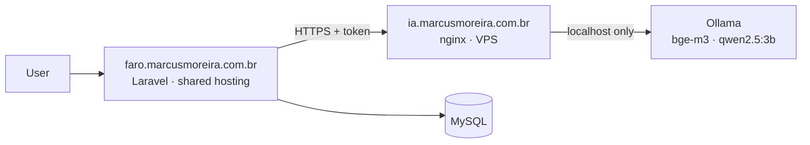

<p align="center">
  
</p>

<p align="center"><strong>The AI that finds the right jobs for you.</strong></p>

<p align="center">
  <a href="https://faro.marcusmoreira.com.br">faro.marcusmoreira.com.br</a> ·
  <a href="docs/ROADMAP.md">Roadmap</a> ·
  <a href="docs/DATABASE.md">Database</a> ·
  <a href="docs/DEPLOY.md">Deploy</a>
</p>

<p align="center">
  <a href="https://github.com/MarcusVBMoreira/faro-vagas/actions/workflows/ci-deploy.yml"></a>
</p>

---

**Faro** helps students and early-career developers in Brazil find internship and junior tech jobs. You upload your résumé, an AI builds your profile, and Faro ranks job openings by how well they fit you, showing a **match score**, your **strengths** and the **skills you're missing** for each one.

The product is in Brazilian Portuguese (it targets the Brazilian job market); the code and this documentation are in English and Portuguese.

> 🚧 Portfolio project, built in public. Follow the progress on the [roadmap](docs/ROADMAP.md).

## Features

- [x] Sign up, login with brute-force throttling, password reset by email
- [x] Résumé upload (PDF) with text extraction and AI parsing in a background queue
- [x] "My profile" page: review and fix what the AI extracted (skills, level, city, work mode...)
- [x] Account deletion that wipes all user data and files (LGPD, Brazil's GDPR)
- [ ] Daily job collection from public sources *(week 2)*
- [ ] Job matching with embeddings + score *(week 3)*
- [ ] Application Kanban board and daily email digest *(week 4)*

## Self-hosted AI, no paid API

The AI runs on the project's own VPS with **Ollama**, exposed at `ia.marcusmoreira.com.br` behind nginx with HTTPS, a bearer token and rate limiting. Résumés **never leave the project's servers**, and the cost per request is zero.



Before choosing the models, I benchmarked them on the VPS (1 vCPU, 4 GB RAM, no GPU). The scripts and results are in [`ops/vps/`](ops/vps/):

| Task | Where it runs | Why |
|---|---|---|
| Embeddings | `bge-m3` on the VPS (~1 s per job posting) | Fast on CPU and handles Portuguese well |
| Parsing résumés and job postings into JSON | `qwen2.5:3b` on the VPS, in a queue (~25–40 s) | Got every field right in the benchmark; the 1.5b model mislabeled the seniority level |
| Match score, strengths and missing skills | **Plain PHP** (skill list comparison + similarity) | Must be exact: in the benchmark, small models invented missing skills |

What small models still get wrong ("3º semestre" instead of `3`, `"Mauá/SP"` as a city, accented enum values) is fixed deterministically in [`ProfileNormalizer`](app/Support/ProfileNormalizer.php), and the response is constrained with a JSON Schema.

## How matching works *(weeks 2–3)*

Sending every job posting to an LLM would be slow and expensive, so Faro uses a three-step funnel:

1. **SQL filters**: level, work mode, location and semester discard most postings at no cost.
2. **Semantic similarity**: the profile and each posting become embeddings; the ~20 closest postings move on.
3. **Score in code**: required vs. nice-to-have skills the candidate has, plus similarity, produce the score, strengths and gaps, with no hallucinations.

## Tech stack

- **Laravel 12** (PHP 8.3), Blade, Tailwind CSS 4, Vite
- **MySQL** in production; queue and cache in the database (no Redis needed on shared hosting)
- **Ollama** on a VPS (`bge-m3` + `qwen2.5:3b`), called over HTTPS
- **PHPUnit** tests running against MySQL 8 on **GitHub Actions**
- **Continuous deployment** to Hostinger over SSH on every push to `main`, plus VPS operations as versioned scripts run by GitHub Actions

## Running locally

Requirements: PHP 8.2+, Composer, Node 20+ (on Windows, XAMPP ships PHP).

```bash
git clone https://github.com/MarcusVBMoreira/faro-vagas.git
cd faro-vagas
composer install
cp .env.example .env          # Windows: copy .env.example .env
php artisan key:generate
php artisan migrate --seed    # uses SQLite at database/database.sqlite
npm install
composer run dev              # http://localhost:8000 (server, queue, logs and Vite)
```

To use XAMPP's MySQL, set `DB_CONNECTION=mysql`, `DB_DATABASE=faro`, `DB_USERNAME=root` and an empty `DB_PASSWORD` in `.env`.
Résumé parsing needs `AI_API_KEY` (the token of your Ollama endpoint) or your own local Ollama with `AI_BASE_URL=http://localhost:11434`.

Tests: `php artisan test`

## Project structure

```
app/Contracts/AiClient.php     AI provider interface (Ollama today, swappable)
app/Services/Ai/               Ollama client: token, timeouts, usage log, daily limit
app/Services/Resume/           PDF text extraction and résumé analysis
app/Support/ProfileNormalizer  fixes and normalizes the model's JSON
app/Services/SkillCatalog      "js" → JavaScript, "C#" → c-sharp: one skill vocabulary
app/Jobs/AnalyzeResume         background job: PDF → AI → profile
database/                      migrations, seeders and factories
docs/                          roadmap, database model, deploy guide, brand
ops/vps/                       VPS scripts (benchmark, swap, nginx + HTTPS + token)
design/                        brand assets and screenshots (not deployed)
```

## Author

**Marcus Moreira**, Software Engineering student at Fundação Santo André (Brazil).
