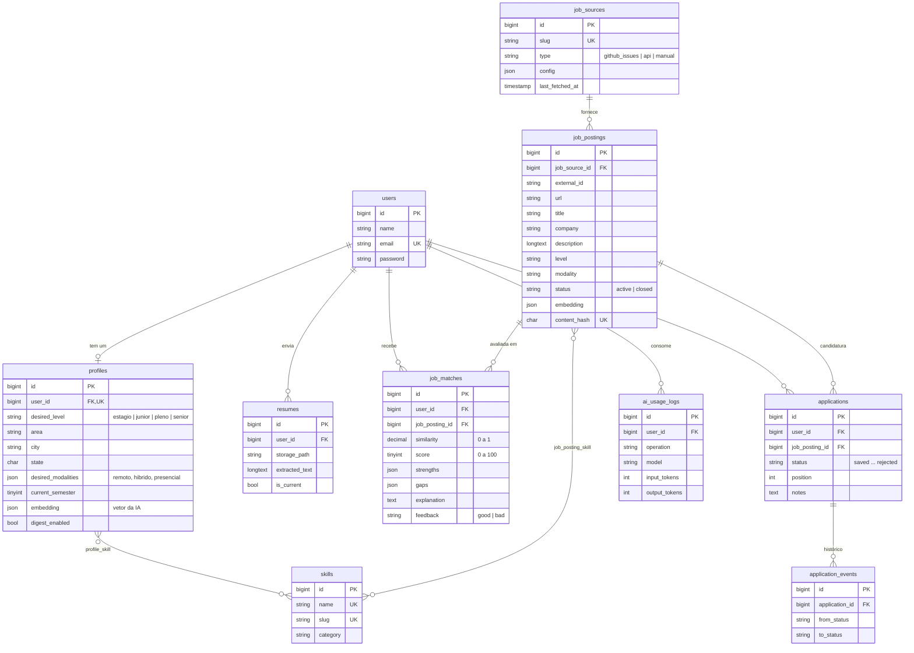

# Modelagem do banco de dados

Banco: **MySQL** (Hostinger) em produção, MySQL 8 nos testes do GitHub Actions e SQLite opcional no desenvolvimento local.
Todas as tabelas são criadas pelas migrations em `database/migrations/`.

## Diagrama

## Tabelas

| Tabela | Para que serve |
|---|---|
| `users` | Contas (padrão do Laravel). |
| `profiles` | Perfil profissional montado pela IA a partir do currículo e revisado pelo usuário. Guarda o **embedding** (vetor) usado no match. |
| `skills` | Catálogo único de habilidades (PHP, React, Git...), compartilhado entre perfis e vagas. |
| `profile_skill` | Habilidades de cada perfil, com nível de 1 a 5 e a origem (`ai` ou `manual`). |
| `resumes` | Currículos enviados e o texto extraído do PDF. Só um fica `is_current`. |
| `job_sources` | Fontes de vagas. Cada `type` terá um conector próprio. |
| `job_postings` | Vagas coletadas. O nome não é `jobs` porque essa tabela já é a fila do Laravel. |
| `job_posting_skill` | Tecnologias de cada vaga, separando obrigatórias de diferenciais. |
| `job_matches` | Resultado do funil de match: similaridade (embeddings) + nota, pontos fortes e lacunas (IA). |
| `applications` | Candidaturas no Kanban, com a posição dentro de cada coluna. |
| `application_events` | Histórico de mudanças de status, criado automaticamente pelo model `Application`. |
| `ai_usage_logs` | Cada chamada à IA, para controlar custo e limitar uso por usuário. |
| `jobs`, `failed_jobs`, `cache`, `sessions`... | Infraestrutura do Laravel (fila, cache e sessões no próprio banco, sem precisar de Redis). |

## Decisões

- **Enums como texto + enums do PHP** (`app/Enums`): o banco guarda `'estagio'`, o código usa `JobLevel::Estagio`. Funciona igual no MySQL e no SQLite e é fácil adicionar um valor novo sem migration.
- **Embeddings em JSON:** a hospedagem compartilhada não tem banco vetorial. Os filtros SQL (nível, modalidade, cidade) reduzem as vagas para algumas centenas e a similaridade é calculada em PHP. Se um dia migrar para a VPS com pgvector ou MariaDB 11.7+, só a classe de match muda.
- **`content_hash` único:** impede salvar a mesma vaga duas vezes, mesmo vindo de fontes diferentes.
- **Apagar a conta apaga tudo do usuário** (`cascadeOnDelete`): perfil, currículos, matches e candidaturas. Exigência da LGPD. As vagas continuam, porque não pertencem a ninguém.
