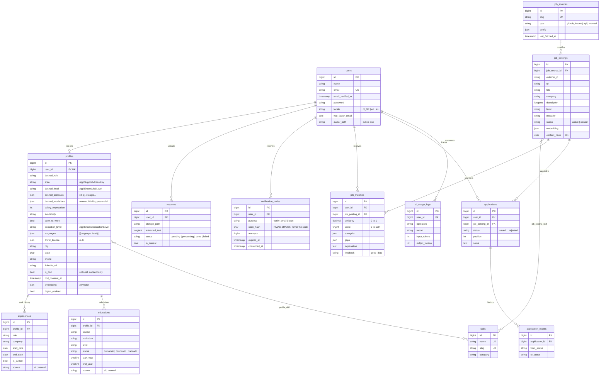

# Database model

Database: **MySQL** (Hostinger) in production, MySQL 8 in the GitHub Actions tests and optional SQLite for local development.
Every table is created by the migrations in `database/migrations/`.

## Diagram

## Tables

| Table | Purpose |
|---|---|
| `users` | Accounts, plus the preferred language, the optional 2FA flag and the optional photo. |
| `verification_codes` | 6-digit email codes for sign-up verification and two-step login. Only an HMAC of the code is stored; codes expire after 15 minutes, allow 5 attempts and are single-use. |
| `profiles` | Professional profile built by the AI from the résumé and reviewed by the user. Covers every field: desired role, field, level, contracts, salary, availability, education, languages, driver's license and contact. Stores the **embedding** used for matching. |
| `experiences` | Work history (jobs, internships, volunteering, freelance). |
| `educations` | Courses: high school, technical, college, postgraduate. |
| `skills` | Single skill catalog (Excel, customer service, forklift, NR-35, PHP...), shared by profiles and postings. |
| `profile_skill` | Skills of each profile, with a 1–5 level and the source (`ai` or `manual`). |
| `resumes` | Uploaded résumés and the text extracted from the PDF. Only one is `is_current`. |
| `job_sources` | Job sources. Each `type` gets its own connector. |
| `job_postings` | Collected postings. It isn't called `jobs` because that table is Laravel's queue. |
| `job_posting_skill` | Skills of each posting, split into required and nice-to-have. |
| `job_matches` | Result of the match funnel: similarity (embeddings) plus score, strengths and gaps. |
| `applications` | Applications on the Kanban board, with their position inside each column. |
| `application_events` | Status change history, created automatically by the `Application` model. |
| `ai_usage_logs` | Every AI call, to track cost and limit usage per user. |
| `jobs`, `failed_jobs`, `cache`, `sessions`... | Laravel infrastructure (queue, cache and sessions in the database itself, no Redis needed). |

## Decisions

- **Enums stored as text + PHP enums** (`app/Enums`): the database stores `'estagio'`, the code uses `JobLevel::Estagio`. Works the same on MySQL and SQLite, and adding a value needs no migration. The 28 fields live in `App\Support\Areas` for the same reason.
- **Stored values stay in Portuguese, labels are translated.** Keys such as `saude` or `ensino_medio` never change; `__()` turns them into Portuguese, English or Spanish labels at display time.
- **AI vs. manual data:** `experiences`, `educations` and `profile_skill` carry a `source`. A new résumé replaces only what the AI created; what the user typed is never overwritten.
- **Sensitive data (LGPD):** the disability field is `null` unless the user explicitly answers, `pcd_consent_at` records when, and the match score never reads it.
- **Embeddings as JSON:** shared hosting has no vector database. SQL filters (field, level, work mode, city) narrow postings down to a few hundred and similarity is computed in PHP. If the project moves to the VPS with pgvector or MariaDB 11.7+, only the match class changes.
- **Unique `content_hash`:** prevents storing the same posting twice, even from different sources.
- **Deleting the account deletes everything the user owns** (`cascadeOnDelete` plus the files): profile, photo, résumés, codes, matches and applications. Postings stay, since they belong to nobody.
